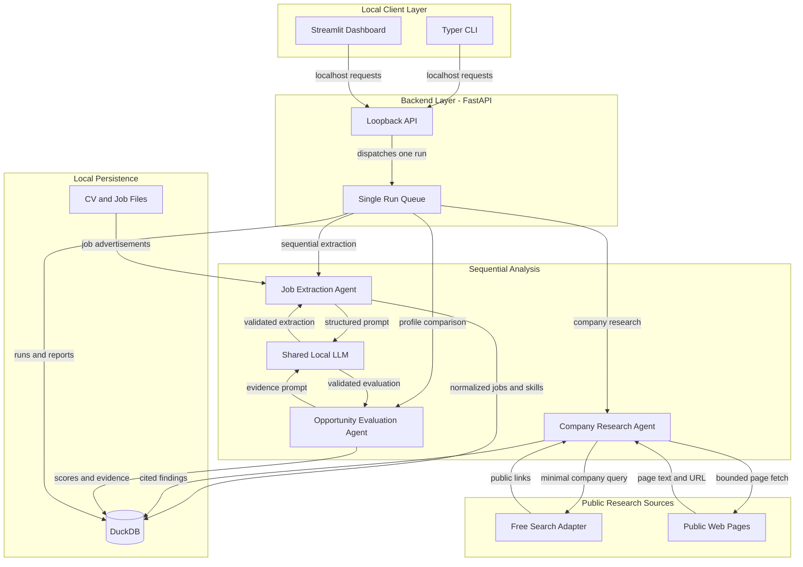
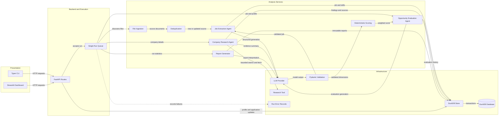

# Architecture Diagram

Career Intelligence Agent is a local-first application that evaluates job advertisements against a user-controlled career profile. The CLI and dashboard share one loopback backend, model instance, sequential analysis queue, and local DuckDB store.

## Application Architecture

<!-- mermaid-checked: no \n, no em-dash/en-dash, no {} in labels, subgraphs are id["label"], arrows are -->|"label"|, all subgraphs closed by end, ids unique -->

### Technology Stack Summary

| Layer | Technology | Version | Purpose |
|---|---|---|---|
| Client | Python | 3.11+ | Shared application runtime |
| CLI | Typer | 0.12+ | Explicit run, status, job, report, profile, and backup commands |
| Dashboard | Streamlit | 1.39+ | Job explorer, review, reports, insights, applications, and settings |
| Backend | FastAPI and Uvicorn | 0.115+ / 0.30+ | Loopback API and sole owner of model and database writes |
| Analysis | Pydantic | 2.8+ | Structured validation and typed domain models |
| Local inference | Transformers, PyTorch, Accelerate | 4.45+ / 2.4+ / 0.30+ | Lazy local Qwen3 inference on MPS or CPU |
| Persistence | DuckDB | 1.1+ | Local transactional career and analysis store |
| Document parsing | Beautiful Soup, pypdf, python-docx | 4.12+ / 5.0+ / 1.1+ | HTML extraction and CV parsing |
| Company research | DuckDuckGo HTML search and public HTTP(S) pages | Free adapter | Bounded, attributable public company research |

### Data Storage & External Services

DuckDB stores career-profile versions, canonical jobs and source versions, normalized job skills, company research and source timestamps, evaluations, application events, processing runs/errors, and immutable reports. CV and job input files remain in the user-selected local directories. The local model is downloaded once from Hugging Face and then reused for inference. Company research can contact DuckDuckGo and public webpages; no CV content is sent externally, and research findings are retained only with source evidence.

### Key Architectural Decisions

- Both user interfaces use one loopback FastAPI backend; only that backend owns the LLM runtime, analysis queue, and DuckDB write connection.
- Analysis is sequential and deterministic scoring/report statistics are computed in Python; the LLM extracts and interprets evidence but does not calculate aggregate report counts.
- Exact and normalized hashes precede text-similarity identity checks; original source versions and manual application history are kept separately.

## Component Relationships

<!-- mermaid-checked: no \n, no em-dash/en-dash, no {} in labels, subgraphs are id["label"], arrows are -->|"label"|, all subgraphs closed by end, ids unique -->

### Component Inventory

| Component | Layer | Type | Responsibility |
|---|---|---|---|
| Typer CLI | Presentation | Command interface | Starts runs and queries the shared backend |
| Streamlit Dashboard | Presentation | Web UI | Profile editing, job review, reports, application tracking, settings |
| FastAPI Routes | Backend | Local API | Validates requests and coordinates the backend services |
| Single Run Queue | Backend | Execution service | Serializes analysis runs and rejects overlapping work |
| File Ingestion | Analysis | Parser service | Discovers and reads job files and supported CV formats |
| Deduplication | Analysis | Deterministic service | Hashes and compares sources before accepting canonical jobs |
| Job Extraction Agent | Analysis | LLM agent | Extracts evidence-backed, normalized job details |
| Company Research Agent | Analysis | LLM agent | Summarizes public company information with source attribution |
| Opportunity Evaluation Agent | Analysis | LLM agent | Produces evidence-based fit, growth, uncertainty, and action assessments |
| Deterministic Scoring | Analysis | Scoring service | Calculates weighted opportunity and job-fit scores |
| Report Generator | Analysis | Analytics service | Computes aggregates and creates the two historical report snapshots |
| LLM Provider | Infrastructure | Runtime abstraction | Lazily loads and reuses the configured local Transformers model |
| Research Tool | Infrastructure | Adapter | Provides free search and bounded public-page retrieval |
| DuckDB Store | Infrastructure | Persistence service | Owns database schema, transactions, and data access |
| DuckDB Database | Data | Embedded database | Persists profiles, jobs, sources, research, evaluations, applications, and reports |
| Pydantic Validation | Cross-cutting | Validation | Checks structured model output and API inputs |
| Run Error Records | Cross-cutting | Reliability | Captures retryable per-file and run-stage failures |
