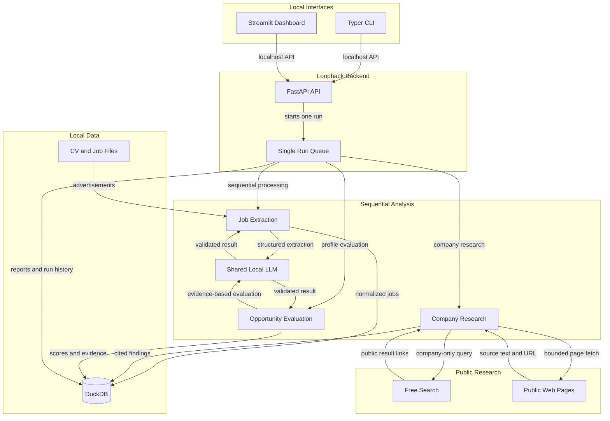

# Career Intelligence Agent

A local-first career decision-support tool that analyzes job advertisements against your career profile and CV, researches public employer information, scores fit and growth potential, and tracks applications. It is an analysis and tracking system; it does not apply for jobs automatically.

The implementation follows [requirements.md](./requirements.md). It uses one local FastAPI backend as the sole owner of the LLM and DuckDB connection; the CLI and Streamlit dashboard call that backend over loopback.

## Architecture

<!-- mermaid-checked: no \n, no em-dash/en-dash, no {} in labels, subgraphs are id["label"], arrows are -->|"label"|, all subgraphs closed by end, ids unique -->


The detailed two-layer diagrams and component inventory are in [architecture-diagram.md](./.github/modernize/assessment/engines/facts/architecture-diagram.md).

## Requirements

- Python 3.11 or newer.
- Recommended configuration: Apple Silicon Mac with 24-32 GB unified memory.
- Intel Macs and Linux CPU systems can use CPU inference when compatible PyTorch wheels are available; expect slower inference and substantial RAM use. Linux NVIDIA GPUs can be configured for CUDA with a matching PyTorch build, a supported dtype, and sufficient VRAM.
- Internet access is needed only to download the local model and optionally research public employer pages.
- No Docker, paid LLM API, or paid search service is required.

## Install

From the project directory:

```bash
python3 -m venv .venv
source .venv/bin/activate
python -m pip install --upgrade pip
python -m pip install -e ".[test]"
```

The local Transformers/PyTorch dependencies are sizable. You do not need to download the model manually: when the first analysis or CV import needs it, the app downloads `Qwen/Qwen3-4B-Instruct-2507` from Hugging Face. Hugging Face stores it in its cache, normally under `~/.cache/huggingface/hub/` on macOS and Linux. This is separate from the app data directory and the project folder. Later runs reuse the cached files.

To keep the model cache on another disk, set `HF_HOME` before starting the backend. The model cache will be stored under `$HF_HOME/hub/`:

```bash
export HF_HOME="/path/to/large-disk/huggingface"
career-agent serve
```

Set `HF_HOME` before the first model download. If you have already downloaded the model, keep using the same cache location or let Hugging Face download it to the new cache. The default model ID can be changed in the dashboard settings or in `~/.career-agent/settings.yaml`; it can be a Hugging Face repository ID or a path to a compatible model directory already on disk.

The default data directory is `~/.career-agent/`. To use another directory, set `CAREER_AGENT_HOME` before starting the backend:

```bash
export CAREER_AGENT_HOME="$HOME/career-agent-data"
mkdir -p "$CAREER_AGENT_HOME/jobs"
```

Job inputs can be `.txt`, `.md`, `.html`, or `.htm`. Each file should contain one advertisement. CV imports can be `.txt`, `.md`, `.pdf`, or `.docx`.

## Start the application

Open two terminals in the project directory and activate the virtual environment in each.

Terminal 1 - backend:

```bash
career-agent serve
```

The API binds to `127.0.0.1` only. It owns the DuckDB write connection, local model runtime, and one-at-a-time analysis queue.

Terminal 2 - dashboard:

```bash
career-agent dashboard
```

Open `http://127.0.0.1:8501`. The dashboard includes job browsing and filtering, job details, reports, market insights, application tracking, profile/CV review, settings, run history, and database backup/restore.

## Configure your profile and CV

1. In **Settings and Runs**, use the profile editor to set target roles, technologies, existing and desired skills, location/work-mode preferences, languages, salary expectations, career priorities, and hard constraints.
2. Optionally upload a CV or run `career-agent profile import-cv /path/to/cv.pdf`. CV text is parsed and analyzed locally.
3. Review and correct extracted experience, skills, projects, education, and certifications before analysis. Information absent from the CV remains unverified; it is not automatically classified as a skill gap.
4. Put job advertisements under `~/.career-agent/jobs/` (or your configured input directory).

The active profile is stored in `~/.career-agent/career-profile.yaml` and versioned in DuckDB. CV content is not sent to search tools.

CV extraction waits for the local model to finish and can take several minutes, especially on the first run or on CPU. Keep the backend and client running while it works. If the client disconnects, the backend may still finish and save the profile; check the current profile before retrying.

## Run and inspect analysis

Start analysis explicitly from the dashboard or CLI:

```bash
career-agent run
career-agent run --wait
career-agent run --input-directory /path/to/job-ads --force --wait
career-agent status
career-agent jobs list
career-agent jobs show <job-id>
career-agent reports list
career-agent reports show <report-id>
career-agent profile show
```

Each run independently processes files, detects duplicates, researches companies within configured free-search limits, evaluates opportunities, and saves exactly two historical report types: **New Jobs** and **All Jobs**. A run with no new jobs still creates both reports. Failed files can be retried on a later run; use `--force` to reprocess unchanged files. Application notes and event history are preserved when a job advertisement is updated.

Job fit and opportunity quality are separate scores. The fit score combines technical and experience fit. The opportunity score is a deterministic weighted aggregation of six evidence-based dimensions; weights are editable in the dashboard. Job skills not verified by the profile are classified as unverified, not missing. Only explicitly listed `known_skill_gaps` can be reported as likely missing. Unknown company or job information is reported as uncertainty, not treated as a proven negative.

## Configuration and research

The settings page edits:

- Model ID, inference device/dtype, context limit, and output limit.
- Public research enablement, query/page budgets, and timeout.
- Weights for technical fit, experience fit, career alignment, learning potential, engineering environment, and practical constraints.

The defaults use Apple Silicon MPS and BF16. On an Intel Mac or CPU-only Linux system, set `model.device` to `cpu` and `model.dtype` to `float32` in the settings page or `settings.yaml`. On Linux with a compatible NVIDIA setup, `model.device` can be set to `cuda`; choose a dtype supported by that GPU and its PyTorch build. Alternate hardware has not been benchmarked, and CPU inference may be significantly slower.

Research uses a free DuckDuckGo HTML search adapter and public webpage fetches. Limits default to at most 5 searches and 10 pages per company, with a 60-second time budget. Retrieval checks `robots.txt`, follows no login or CAPTCHA flows, rejects non-public/private network destinations, records URLs and retrieval timestamps, and validates quoted evidence against retrieved text. Search availability is not guaranteed. When research cannot be verified, the system records the limitation instead of inventing employer claims. Only minimal company-focused queries are sent externally; CV content is not sent.

Settings are stored under the data directory in `settings.yaml`. `CAREER_AGENT_HOME` changes the default data directory; `CAREER_AGENT_SETTINGS` can point to an explicit settings file.

## Database and backups

DuckDB, profiles, job sources, research evidence, evaluations, reports, errors, and application events are stored locally under `~/.career-agent/`.

```bash
career-agent backup --name before-update
career-agent restore before-update
```

Restore requires confirmation and leaves a safety copy of the active database. Backups are local DuckDB export directories under `~/.career-agent/backups/`.

## Tests

Run the focused automated tests:

```bash
python -m pytest
```

The suite covers text normalization/chunking, canonical skill aliases, DuckDB persistence and restore, application history preservation, API run lifecycle, report generation, source-evidence validation, model-output retry, and repeat-run idempotency. The synthetic, manually labeled, 21-ad benchmark includes English, Swedish, Bengali, HTML, and inconsistent formats. Once the local model has downloaded, measure its results with:

```bash
python scripts/run_benchmark.py --output benchmark-results.json
```

The runner reports core-field and required/preferred-skill accuracy against the 95% and 90% acceptance targets. These targets are not claims about the unbenchmarked local model. Results should be reviewed before using them to make career decisions.

## Data location and privacy

- CVs and job inputs are read from local files; the CV file itself is not copied into the database.
- Inference runs locally. The first model download is from Hugging Face.
- Public research sends only limited employer/search queries, not the CV.
- The backend and dashboard bind to loopback by default.
- Advertisements and retrieved webpages are treated as untrusted text, not executable instructions.
- No secrets are required by the default MVP.
